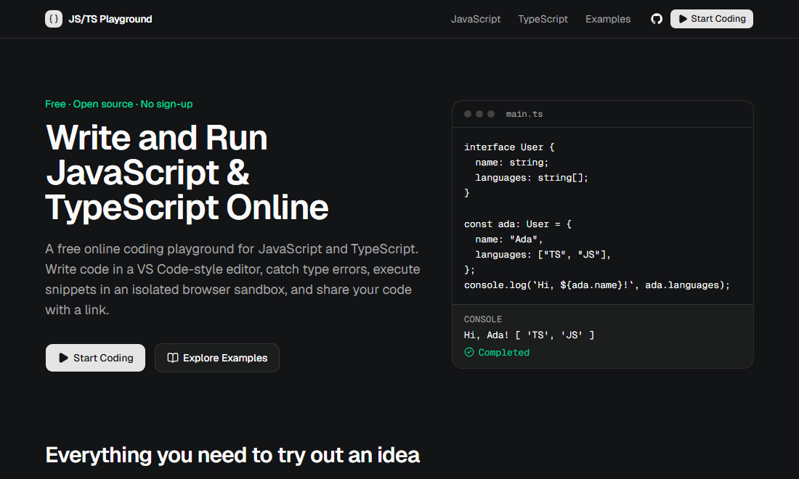

# JS/TS Playground

[](https://github.com/ChandrakantBudhalakoti/js-ts-playground/actions/workflows/ci.yml)
[](LICENSE)

A free, open-source online playground for JavaScript and TypeScript. Write
code in a VS Code-style editor (Monaco), get autocomplete and real TypeScript
type checking, and run it in an isolated browser sandbox with a console for
output and errors. Nothing to install, no account.

**[Live demo: js-ts-playground-eight.vercel.app](https://js-ts-playground-eight.vercel.app/)**
· [Open the editor](https://js-ts-playground-eight.vercel.app/playground)
· [Examples](https://js-ts-playground-eight.vercel.app/examples)


## Demo



## Features

- **Editor:** Monaco with syntax highlighting, autocomplete, hover, parameter
  hints, bracket matching, Prettier formatting and keyboard shortcuts.
- **TypeScript:** transpilation with `ts.transpileModule` plus semantic type
  checking from an in-memory language service, so `const age: number = "25"`
  is a real error.
- **Problems panel:** severity, message, code and position for each
  diagnostic, matching the editor's squiggles. Click one to jump to it.
- **Sandboxed execution:** a sandboxed iframe with an opaque origin runs your
  code in a Web Worker. Timeouts and Stop work even on `while (true) {}`.
- **Console:** `log`, `info`, `warn`, `error`, `debug`, plus groups, counters
  and timers. It handles circular references safely, renders text only (never
  HTML), and caps output.
- **Examples:** runnable JavaScript and TypeScript examples in the editor's
  Examples menu. Any of them opens directly at `/playground?example=<id>`, and
  five have guide pages that explain them.
- **Sharing and drafts:** share links keep the code compressed in the URL hash
  (no server storage), and your draft is saved in the browser.
- **Extras:** editor settings, dark and light themes and a mobile layout.

### Keyboard shortcuts

| Shortcut          | Action                                      |
| ----------------- | ------------------------------------------- |
| `Ctrl/⌘ + Enter`  | Run                                         |
| `Shift + Alt + F` | Format with Prettier                        |
| `Ctrl/⌘ + S`      | Save the draft now (it also autosaves)      |
| `Ctrl/⌘ + Z`      | Undo, including a replaced example or reset |

## Pages

| Route                                             | What it is                                                                                 |
| ------------------------------------------------- | ------------------------------------------------------------------------------------------ |
| `/`                                               | Landing page: features, how it works, limitations, FAQ                                     |
| `/playground`                                     | The editor. `?example=<id>` opens an example; `#lang=…&code=…` is a share link             |
| `/javascript`, `/typescript`                      | What each language supports, the runtime environment, compiler settings and examples       |
| `/examples`, `/examples/<slug>`                   | All examples, and guides for async/await, array methods, promises, interfaces and generics |
| `/sandbox`                                        | The page the code runs in (framed by the editor, `X-Robots-Tag: noindex`)                  |
| `/sitemap.xml`, `/robots.txt`, `/opengraph-image` | Generated sitemap, robots rules and social-sharing image                                   |

Share links created before the editor moved to `/playground` point at
`/#lang=…&code=…`; the home page forwards them, so they keep working.

## Quick start

Requirements: Node.js 20.19 or newer (CI uses Node 24, see `.nvmrc`) and npm.

```bash
npm install      # also copies Monaco and the TypeScript libs into public/vendor
npm run dev      # http://localhost:3000 (the editor is at /playground)
```

## Scripts

| Script                 | What it does                                                              |
| ---------------------- | ------------------------------------------------------------------------- |
| `npm run dev`          | Development server (Turbopack).                                           |
| `npm run build`        | Production build.                                                         |
| `npm start`            | Serve the production build.                                               |
| `npm run lint`         | ESLint. Warnings fail the run.                                            |
| `npm run typecheck`    | Generate Next.js route types (`next typegen`), then `tsc --noEmit`.       |
| `npm run format`       | Format everything with Prettier.                                          |
| `npm run format:check` | Fail if anything is not Prettier-formatted.                               |
| `npm test`             | Unit tests (Vitest).                                                      |
| `npm run test:e2e`     | Browser tests (Playwright). Builds the app and runs it with `next start`. |
| `npm run check`        | lint, typecheck, format check, unit tests and build: the same gate as CI. |

The first time you run browser tests, install the browsers with
`npx playwright install chromium firefox`. To test a server that's already
running instead of building one, set `PLAYWRIGHT_BASE_URL`
(for example `PLAYWRIGHT_BASE_URL=http://localhost:3000 npm run test:e2e`).

`predev` and `prebuild` run `scripts/prepare-assets.mjs`, which generates
`public/vendor/` (git-ignored):

- `public/vendor/monaco/<version>/vs`: Monaco's prebuilt bundle, so the editor
  is served from this origin rather than a CDN. Cached as immutable.
- `public/vendor/typescript/<version>/lib.json`: the TypeScript `lib.*.d.ts`
  files the type checker needs, resolved from `src/lib/compiler/lib-roots.json`.
  Its content depends on that file too, so it is served with
  `must-revalidate` rather than as immutable.

`postinstall` runs the same script with `--optional`, which skips anything
whose package is missing. A production-only install (`npm ci --omit=dev`, for
example in a Docker runtime stage) has no `typescript` package, but the build
has already generated the assets, so this is safe.

## Architecture

```text
src/
  app/
    layout.tsx                Site-wide metadata, theme, tooltip and toast providers
    (site)/                   Content pages with a shared header and footer:
      page.tsx                  / (landing page)
      javascript/, typescript/  Language pages
      examples/                 Example index and one folder per guide
    playground/page.tsx       The editor: renders <Playground />
    sandbox/route.ts          The sandbox page, with its own strict CSP
    sitemap.ts, robots.ts     Generated /sitemap.xml and /robots.txt
    opengraph-image.tsx       Generated social-sharing image
    not-found.tsx, error.tsx  404 page and error boundary
  components/
    playground/Playground.tsx Orchestration: document, run flow, sharing, ?example=, shortcuts
    layout/PlaygroundLayout   Resizable editor/output on desktop, tabs on mobile
    editor/                   CodeEditor (Monaco), toolbar, language, examples, settings, status
    console/                  ConsolePanel, ConsoleEntry
    diagnostics/              ProblemsPanel
    site/                     Header, footer, guide article and other content-page components
    ui/                       shadcn/ui primitives
  hooks/
    useCodeExecution.ts       Sandbox runtime + console state (batched per frame)
    useDiagnostics.ts         Debounced type checking; stale responses are dropped
    useCompiler.ts            Shared compiler-worker client
    useEditorSettings.ts      Persisted preferences
  lib/
    compiler/                 Language service, transpile, diagnostics, source maps, worker
    runtime/                  Sandbox document, parent runtime, protocol validation, serializer
    console/format.ts         util.inspect-style text formatting, printf substitutions
    monaco/setup.ts           Monaco configuration (TS options, themes, Prettier provider)
    sharing/encode-code.ts    URL-hash share links
    examples.ts, guides.ts    Runnable examples and the guide pages that explain them
    site.ts, metadata.ts      Canonical URL, site name, per-page metadata helper
    content.ts                Landing-page FAQ and copy shared with structured data
  types/playground.ts         Shared types (Language, Diagnostic, ConsoleEntry, RuntimeMessage, ...)
tests/
  unit/                       Compiler, diagnostics, serializer, protocol, formatting, sharing, sitemap and content
  e2e/                        Editor, runtime, sharing, mobile, guides, SEO metadata and accessibility (axe)
```

Links into and out of `/playground` are plain `<a>` elements (full page
loads), not `next/link`. With Cache Components, client-side navigation keeps a
page mounted but hidden in React's `<Activity>`, and the editor, sandbox and
URL handling are built for a real mount and unmount.

### Type checking

- A dedicated Web Worker runs the `typescript` package (pinned to **5.9.3**,
  the version bundled inside `monaco-editor` 0.57) through an in-memory
  language service. It needs no disk access. Results are syntactic + semantic
  - compiler-option diagnostics, de-duplicated and converted to one-based
    positions.
- Monaco's built-in TypeScript service provides completions, hover and
  signature help. Its own diagnostics are switched off, so the editor markers
  and the Problems panel come from a single source. Both services share the
  compiler options in `src/lib/compiler/options.ts` and the same lib set
  (ES2024 plus Web Worker globals, matching where code actually runs).
- Every file is treated as a module, so top-level `await` works.

**Run policy:** syntax errors block a run, because the code can't execute
correctly. Type errors don't: the run proceeds with a warning in the console,
the same way `tsc` still emits JavaScript. Turn on _Settings → Block Run on
type errors_ to make type errors block too.

### How code runs

1. On **Run**, the code is compiled: TypeScript is transpiled with a source
   map, and JavaScript runs unchanged.
2. The app creates a fresh `<iframe sandbox="allow-scripts">` pointing at
   `/sandbox`. Without `allow-same-origin` the frame gets an **opaque origin**:
   it can't read the app's DOM, cookies or storage.
3. The sandbox page starts a **Web Worker** and imports the code into it as an
   ES module from a `blob:` URL. `console`, timers and uncaught errors are
   instrumented and their output sent back with `postMessage`.
4. The app accepts a message only if all of these hold: it comes from the
   current iframe's window, its origin is `"null"`, it carries the expected
   channel and run ID, it fits the size limits, and it passes schema
   validation. Anything else is dropped.
5. A run completes when the module has finished and no timers are pending.
   The **timeout lives in the app**, not in the sandbox. When it fires, or on
   **Stop**, the iframe is removed, which kills its worker even mid-loop. After
   completion the sandbox stays alive for one more second to deliver late
   output, then it is removed too. Every run gets a new iframe, so output from
   an old run can never reach a new one.

Limits (in `src/lib/runtime/protocol.ts`): 1,000 console messages per run
(after that the run is stopped), 128 KB per message, 10,000 characters per
string, and bounded depth and item counts for objects.

## Browser limitations

This is **not Node.js**, and the sandbox is a browser sandbox, not a hardened
server-side execution service.

- No `fs`, `process`, `require` or npm packages: `import` statements can't
  load packages, and the type checker reports them as unresolved.
- Compiler options are fixed (strict mode, ES2022 output, ES2024 and Web
  Worker libs; see `src/lib/compiler/options.ts`) and can't be changed in the
  UI.
- Code runs in a Web Worker, so there is no `document` or `window` (the editor
  types match this). `self`, `console`, timers, `crypto`, `structuredClone` and
  similar worker APIs are available.
- Network access is blocked by the sandbox CSP (`connect-src 'none'`), so
  `fetch` throws.
- The default time limit is 5 seconds (configurable up to 30 s), and a
  `setInterval` that never stops counts against it. Async work that isn't
  driven by timers (for example a `crypto.subtle` promise) gets one second
  after "Completed" to log; then the sandbox is destroyed, even if that work
  is still running.
- A browser sandbox depends on the browser's own isolation. Use a separate
  origin in production (below) for process isolation, and keep browsers up to
  date.

## Security model and production setup

| Layer            | Control                                                                                                                                                                                                                          |
| ---------------- | -------------------------------------------------------------------------------------------------------------------------------------------------------------------------------------------------------------------------------- |
| iframe           | `sandbox="allow-scripts"` (never with `allow-same-origin`), `referrerpolicy="no-referrer"`, hidden, recreated per run                                                                                                            |
| Sandbox response | `Content-Security-Policy: default-src 'none'; script-src 'sha256-…' blob: 'unsafe-eval'; worker-src blob:; connect-src 'none'; …; frame-ancestors …; sandbox allow-scripts`, plus `nosniff`, `no-referrer`, `Permissions-Policy` |
| App response     | CSP with `frame-src` limited to the sandbox origin, `object-src 'none'`, `frame-ancestors 'none'`, no `unsafe-eval` in production, `X-Frame-Options: DENY`                                                                       |
| Messages         | Source, origin, channel, run-ID, schema and size validation (`parseRuntimeMessage`)                                                                                                                                              |
| Output           | Rendered as React text nodes. User output is never inserted as HTML                                                                                                                                                              |

The `sandbox` CSP directive keeps the page at an opaque origin even when it's
opened directly. `'unsafe-eval'` is allowed **only inside the sandbox**: that
page already exists to run arbitrary code, so `eval` adds no capability, and
keeping it means `eval` and `new Function` behave as users expect.

### Separate sandbox origin (recommended for production)

By default the sandbox is this app's own `/sandbox` route. It still has an
opaque origin, but browsers may run it in the same process as the app. For
process-level isolation, serve it from a different site:

1. Deploy this same repository a second time, for example as a second Vercel
   project on `sandbox.example.net` (ideally a different registrable domain
   from the app).
2. On the **sandbox** deployment, set
   `SANDBOX_FRAME_ANCESTORS=https://app.example.com` so only the app can frame
   it. The `/sandbox` route reads it on every request, so it can be set or
   changed at runtime without rebuilding.
3. On the **app** deployment, set
   `NEXT_PUBLIC_SANDBOX_URL=https://sandbox.example.net/sandbox`. This one is
   read **at build time** (it is inlined into the client bundle and sets the
   app's CSP `frame-src`), so rebuild after changing it.
4. Redeploy both, then check the headers of each:

   ```bash
   node scripts/verify-security-headers.mjs https://app.example.com
   SANDBOX_FRAME_ANCESTORS=https://app.example.com \
     node scripts/verify-security-headers.mjs https://sandbox.example.net
   ```

### Deploying to Vercel

The app needs no environment variables to work on a single origin, so
importing the repository into Vercel with the default Next.js settings is
enough. The vendor assets are generated during the build.
Never add secrets to `NEXT_PUBLIC_*` variables: they end up in the client
bundle.

Optional build-time environment variables:

| Variable                   | Purpose                                                                                                                                                                                   |
| -------------------------- | ----------------------------------------------------------------------------------------------------------------------------------------------------------------------------------------- |
| `SITE_URL`                 | Canonical origin for canonical links, Open Graph URLs and the sitemap. Defaults to `https://js-ts-playground-eight.vercel.app`. Set it on a fork or self-hosted copy with its own domain. |
| `GOOGLE_SITE_VERIFICATION` | Token for Google Search Console's HTML-tag verification; adds `<meta name="google-site-verification">`.                                                                                   |
| `NEXT_PUBLIC_SANDBOX_URL`  | Separate sandbox origin (see above).                                                                                                                                                      |

## Search engines

Every page sets its own title, description, canonical URL and Open Graph data
through `pageMetadata()` in `src/lib/metadata.ts`, and shares one generated
social image. Preview deployments keep pointing their canonical URLs at
`SITE_URL`, so only production is treated as the original. `/sitemap.xml`
lists every indexable page (new guides are added automatically) and
`/robots.txt` allows crawling and links to it. The landing page includes
`WebApplication` and `FAQPage` structured data, the language pages `FAQPage`,
and the guides `BreadcrumbList`; all of it matches what is visible on the page.

`tests/e2e/site.spec.ts` checks the metadata of every page (unique titles and
descriptions, canonical URLs, one H1), validates the sitemap and robots rules,
and runs axe accessibility checks in both themes.

### Google Search Console (manual, one time)

A `*.vercel.app` subdomain can't be verified through DNS, so use a
**URL-prefix** property with the **HTML tag** method:

1. In [Search Console](https://search.google.com/search-console), add a
   URL-prefix property for `https://js-ts-playground-eight.vercel.app/` and
   choose _HTML tag_. Copy only the `content` value of the tag.
2. In Vercel, under _Project → Settings → Environment Variables_, add
   `GOOGLE_SITE_VERIFICATION` with that value for _Production_, then redeploy
   (the value is read at build time).
3. Back in Search Console, press _Verify_.
4. Under _Sitemaps_, submit `sitemap.xml`.
5. Optionally use _URL inspection → Request indexing_ for `/`, `/playground`,
   `/javascript`, `/typescript` and `/examples`.

Bing Webmaster Tools can import the verified site from Search Console.

## CI and the release gate

`.github/workflows/ci.yml` runs on every pull request and every push to `main`:

| Job       | Checks                                                                                                                                                                            |
| --------- | --------------------------------------------------------------------------------------------------------------------------------------------------------------------------------- |
| `quality` | `npm ci` (lockfile must be in sync), ESLint with warnings as errors, `tsc`, Prettier check, unit tests, production build, then `verify-security-headers.mjs` against `next start` |
| `audit`   | `npm audit --omit=dev --audit-level=high` on production dependencies                                                                                                              |
| `e2e`     | All Playwright tests (Chromium, Firefox, mobile) against the production build. Flaky tests fail the run and `test.only` is rejected. Reports are uploaded as artifacts            |

Dependabot (`.github/dependabot.yml`) proposes weekly npm and GitHub Actions
updates. It leaves `typescript`, `monaco-editor` and `@monaco-editor/react`
alone, because they must move together: Monaco bundles its own TypeScript. When
you upgrade Monaco, set `typescript` to the version Monaco bundles and update
`EXPECTED_TYPESCRIPT_VERSION` and `MONACO_VERSION`. Unit tests fail if these
drift.

CI only stops bad code reaching production if production depends on it. Set
up both of these:

1. **Branch protection on `main`** (_Settings → Rules → Rulesets_, or
   _Branches_): require a pull request, and require the status checks
   `Lint · Types · Format · Unit tests · Build`, `Dependency audit` and
   `Browser tests (Chromium · Firefox · mobile)` to pass, with branches up to
   date before merging.
2. **Vercel:** in _Project → Settings → Deployment Checks_, require the same
   GitHub checks, so a production deployment is only promoted after CI
   passes. Alternatively, deploy from a CI job that `needs:` the jobs above.

Run `npm run check && npm run test:e2e` locally to reproduce CI before you
push.

## Contributing

Contributions are welcome: bug reports, new examples, documentation and code.
See [CONTRIBUTING.md](CONTRIBUTING.md) for setup, conventions and how to add an
example or guide page. Please report security issues privately as described in
[SECURITY.md](SECURITY.md).

## License

[MIT](LICENSE)
