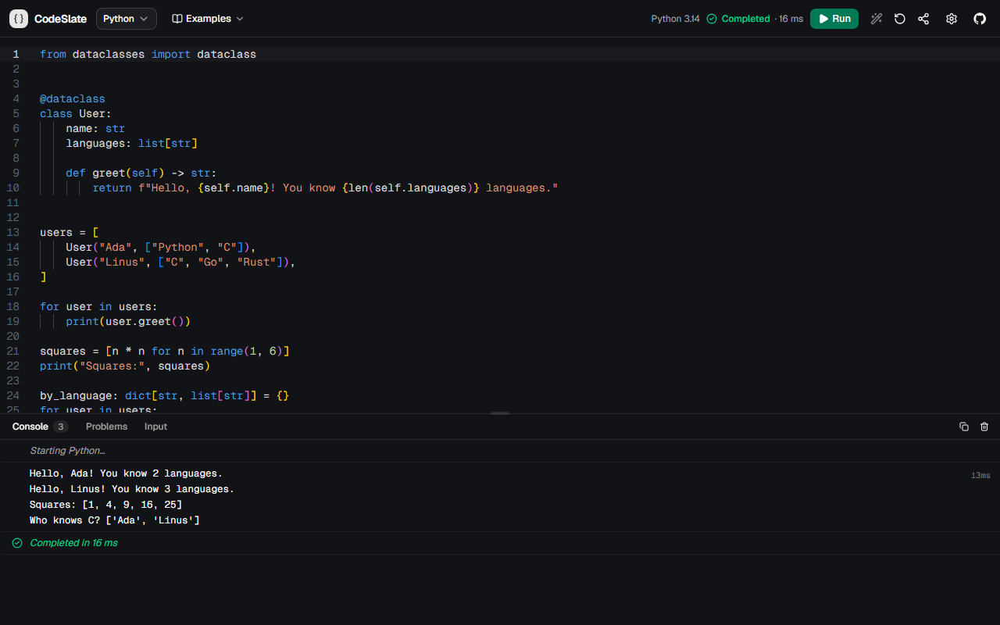

# CodeTakhti

[](https://github.com/ChandrakantBudhalakoti/js-ts-playground/actions/workflows/ci.yml)
[](LICENSE)

A free, open-source online code editor and compiler for Python, C, C++,
JavaScript, TypeScript, Go, Ruby, PHP, Lua and R, built first for phones and
tablets, so anyone can learn to code without a laptop. Write code in a VS
Code-style editor (Monaco), get autocomplete and real TypeScript type checking
(and Clang's errors for C and C++), and run it in an isolated browser sandbox
with a console for output and errors. Every language runs in your browser,
compiled to WebAssembly: your code is never sent to a server. Nothing to
install, no account.

A _takhti_ (तख़्ती) is the wooden slate generations of Indian children
practised writing on. CodeTakhti is that slate for code: learn to code on the
device you already have, the way generations learned to write on a takhti.

The project was first called JS/TS Playground, then CodeSlate. The repository
and the browser storage keys keep the original name, so existing links and
saved drafts still work. The display name is `SITE_NAME` and the canonical
address `SITE_URL`, both in `src/lib/site.ts`.

**[Live demo: code-slatee.vercel.app](https://code-slatee.vercel.app/)**
· [Open the editor](https://code-slatee.vercel.app/playground)
· [Examples](https://code-slatee.vercel.app/examples)



## Demo


## Features

- **Editor:** Monaco with syntax highlighting, autocomplete, hover, parameter
  hints, bracket matching, Prettier formatting and keyboard shortcuts.
- **TypeScript:** transpilation with `ts.transpileModule` plus semantic type
  checking from an in-memory language service, so `const age: number = "25"`
  is a real error.
- **Problems panel:** severity, message, code and position for each
  diagnostic, matching the editor's squiggles. Click one to jump to it. C and
  C++ are checked by Clang as you type. Other languages report errors when
  they run, with a link to the failing line.
- **Ten languages:** JavaScript and TypeScript run natively; Python, C, C++,
  Go, Ruby, PHP, Lua and R run on WebAssembly builds of their usual
  interpreters and compilers (see [Languages](#languages)). Each one is
  downloaded the first time you pick it.
- **Sandboxed execution:** a sandboxed iframe with an opaque origin runs your
  code in a Web Worker, with no network access. Timeouts and Stop work even on
  `while (true) {}`.
- **Standard input:** for languages that read it (`input()`, `scanf`,
  `std::cin`, `gets`…), the Input tab is the program's `stdin`.
- **Console:** `log`, `info`, `warn`, `error`, `debug`, plus groups, counters
  and timers. It handles circular references safely, renders text only (never
  HTML), and caps output.
- **Examples:** runnable examples for every language in the editor's
  Examples menu. Any of them opens directly at `/playground?example=<id>`, and
  five have guide pages that explain them.
- **Beginner programs:** the classic first-year syllabus and lab-file
  programs (Hello World, input and output, even/odd, star patterns, Floyd's
  triangle, prime numbers, factorial, Fibonacci, palindromes, Armstrong
  numbers, arrays, linear search, bubble sort, matrix addition, strings,
  functions, recursion) in Python, C and C++, each with a plain-English
  explanation, sample input already in the Input tab, and its output. Each has
  its own page, such as `/examples/c/star-pattern-pyramid`, and the examples
  page filters by language and level. Java versions are written and checked,
  and appear once Java runs in the playground.
- **Offline and data-friendly:** a service worker saves the app, the editor,
  the TypeScript compiler and each language runtime the first time they are
  used, so anything used once works without internet. Before a language's
  first download the console shows its size (and notes mobile data, Data
  Saver or a slow connection) with Download and Cancel; nothing is ever
  downloaded twice. Settings → Downloaded languages lists what is saved, with
  sizes, and removes a language to free space. An Offline badge shows when
  there is no connection.
- **Hindi and Hinglish:** everyone starts in English; the **हिं / EN** button
  in the toolbar (on every screen size) switches the interface to Hindi
  (हिन्दी) and back, and Settings also offers Hinglish (Hindi in Latin
  script). The choice is remembered. Code and program output are never
  translated; the site's articles stay in English.
- **Friendly error explanations:** under the most common beginner errors
  (Python indentation, missing colons, NameError, adding text and numbers,
  `int(input())` on text, index errors, division by zero, empty input; C and
  C++ missing semicolons, undeclared names, missing `#include`, `scanf`
  without `&`, missing return types, arrays out of bounds, `cin` misuse;
  timeouts in every language), a short explanation in plain English, Hindi or
  Hinglish, with a link to the line. The original error always stays visible.
  The rules are data (`src/lib/friendly-errors/rules.ts`), and Java's are
  ready for when Java runs.
- **Sharing and drafts:** share links keep the code (and the input)
  compressed in the URL hash (no server storage), and your draft is saved in
  the browser.
- **Phones and tablets:** the editor, output, Problems and input each get
  the full screen as tabs, every control is at least 40 px tall on touch
  screens, and a scrollable row of code keys types brackets, quotes,
  operators, Tab and the arrow keys (with auto-closing brackets, like a real
  keyboard). A long press selects a word (keep the finger down and move it to
  select more), a tap on a line number selects the line, and handles and a
  Cut / Copy / Paste / Select all menu work with any selection. The layout
  follows the on-screen keyboard, word wrap is on by default on phones, Share
  opens the system share sheet, and the site can be installed to the home
  screen (web app manifest and icons).
- **Extras:** editor settings and dark and light themes.

### Keyboard shortcuts

| Shortcut          | Action                                      |
| ----------------- | ------------------------------------------- |
| `Ctrl/⌘ + Enter`  | Run                                         |
| `Shift + Alt + F` | Format with Prettier                        |
| `Ctrl/⌘ + S`      | Save the draft now (it also autosaves)      |
| `Ctrl/⌘ + Z`      | Undo, including a replaced example or reset |

## Languages

Every language runs in the browser. JavaScript and TypeScript run directly;
the others run on WebAssembly builds of their usual implementations, which
the app downloads from its own origin the first time you pick the language
(then from the browser cache). The download sizes are gzipped transfers.

| Language   | Runs on                                                                     | First download | Input | Problems while typing |
| ---------- | --------------------------------------------------------------------------- | -------------- | ----- | --------------------- |
| JavaScript | The browser's engine, in a Web Worker                                       | –              | –     | TypeScript (syntax)   |
| TypeScript | TypeScript 5.9, transpiled, then as JavaScript                              | –              | –     | TypeScript (types)    |
| Python     | CPython 3.14 ([Pyodide](https://pyodide.org))                               | 7 MB           | yes   | –                     |
| C          | Clang 22 → WASI ([YoWASP](https://yowasp.org)), C17                         | 27 MB          | yes   | Clang                 |
| C++        | Clang 22 → WASI, C++20 with libc++                                          | 27 MB          | yes   | Clang                 |
| Go         | [Yaegi](https://github.com/traefik/yaegi) Go interpreter                    | 9 MB           | yes   | –                     |
| Ruby       | CRuby 3.4 ([ruby.wasm](https://github.com/ruby/ruby.wasm))                  | 9 MB           | yes   | –                     |
| PHP        | PHP 8.4 CLI ([php-wasm](https://github.com/WordPress/wordpress-playground)) | 8 MB           | yes   | –                     |
| Lua        | Lua 5.4 ([wasmoon](https://github.com/ceifa/wasmoon))                       | 0.2 MB         | yes   | –                     |
| R          | R 4.6 ([webR](https://docs.r-wasm.org/webr/))                               | 15 MB          | –     | –                     |

What to expect from each:

- **Python:** the standard library only (no `pip`, no NumPy). `input()` reads
  the Input tab; `print` output appears as it is printed. Tracebacks keep only
  your own frames and link to the failing line.
- **C and C++:** Clang compiles to WebAssembly in a worker of the app, so the
  first C++ compile of a session takes a few seconds (the standard headers
  are large). Compile errors and warnings (`-Wall`) appear in the Problems
  panel. Programs get `stdin`/`stdout`/`stderr`, clocks and random numbers,
  but no filesystem. **C++ exceptions are not supported:** `throw` ends the
  program with the exception's message, and `catch` blocks never run.
  A non-zero exit status marks the run as failed.
- **Go:** an interpreter, not the Go compiler. Goroutines, channels and most
  of the standard library work; packages outside the standard library,
  `os/exec`, `net` and `unsafe` don't.
- **Ruby, PHP, Lua:** the language's own interpreter and standard library.
  PHP errors go to stderr (red) and use PHP's own format.
- **R:** base R with its standard packages (`stats`, `utils`, `methods`,
  `datasets`…); no package installation and no plots. Top-level
  values print as in `Rscript`, and warnings are shown as they happen.

Each run starts in a fresh interpreter, and the time limit applies to the run,
not to downloading or starting the runtime. After a run, the next sandbox
starts in the background, so later runs don't wait for the runtime to boot.

## Pages

| Route                                                         | What it is                                                                                                                |
| ------------------------------------------------------------- | ------------------------------------------------------------------------------------------------------------------------- |
| `/`                                                           | Landing page: features, how it works, limitations, FAQ                                                                    |
| `/playground`                                                 | The editor. `?example=<id>` opens an example; `#lang=…&code=…` is a share link                                            |
| `/languages`                                                  | Every language, grouped, with links to its page and the editor                                                            |
| `/javascript`, `/typescript`                                  | What each language supports, the runtime environment, compiler settings and examples                                      |
| `/python`, `/c`, `/cpp`, `/go`, `/ruby`, `/php`, `/lua`, `/r` | What runs and what doesn't, the runtime, examples and an FAQ (`src/lib/language-pages.ts`)                                |
| `/manifest.webmanifest`, `/icon/<id>`, `/apple-icon/<id>`     | Web app manifest and generated app icons                                                                                  |
| `/examples`, `/examples/<slug>`                               | All examples (filter by language and level), and guides for async/await, array methods, promises, interfaces and generics |
| `/examples/<language>`, `/examples/<language>/<program>`      | Beginner programs per language (`/examples/python`), and one page per program (`/examples/c/prime-number`)                |
| `/sandbox`                                                    | The page the code runs in (framed by the editor, `X-Robots-Tag: noindex`)                                                 |
| `/sw.js`                                                      | The service worker that keeps the app and used languages working offline (`src/lib/offline/service-worker.ts`)            |
| `/sitemap.xml`, `/robots.txt`, `/opengraph-image`             | Generated sitemap, robots rules and social-sharing image                                                                  |

Share links created before the editor moved to `/playground` point at
`/#lang=…&code=…`; the home page forwards them, so they keep working.

## Quick start

Requirements: Node.js 22 or newer (CI uses Node 24, see `.nvmrc`) and npm.

```bash
npm install      # also copies Monaco, the TypeScript libs and the language runtimes into public/vendor
npm run dev      # http://localhost:3000 (the editor is at /playground)
```

## Scripts

| Script                 | What it does                                                              |
| ---------------------- | ------------------------------------------------------------------------- |
| `npm run dev`          | Development server (Turbopack).                                           |
| `npm run build`        | Production build.                                                         |
| `npm start`            | Serve the production build.                                               |
| `npm run lint`         | ESLint. Warnings fail the run.                                            |
| `npm run typecheck`    | Generate Next.js route types (`next typegen`), then `tsc --noEmit`.       |
| `npm run format`       | Format everything with Prettier.                                          |
| `npm run format:check` | Fail if anything is not Prettier-formatted.                               |
| `npm test`             | Unit tests (Vitest).                                                      |
| `npm run test:e2e`     | Browser tests (Playwright). Builds the app and runs it with `next start`. |
| `npm run check`        | lint, typecheck, format check, unit tests and build: the same gate as CI. |

The first time you run browser tests, install the browsers with
`npx playwright install chromium firefox`. To test a server that's already
running instead of building one, set `PLAYWRIGHT_BASE_URL`
(for example `PLAYWRIGHT_BASE_URL=http://localhost:3000 npm run test:e2e`).

`playwright.config.ts` defines these projects: `chromium` (everything except
the phone and language suites), `firefox` (the runtime suite), `mobile`
(Pixel 7) and `tablet` (iPad, on Chromium) for `mobile.spec.ts`, and
`languages-chromium` and `languages-firefox`, which run the WebAssembly
languages after the others have finished, so their downloads and compiles
don't compete for the CPU. Run one with `npx playwright test --project=mobile`.
WebKit isn't included; check changes on a real iPhone or iPad.

`predev` and `prebuild` run `scripts/prepare-assets.mjs`, which generates
`public/vendor/` (git-ignored):

- `public/vendor/monaco/<version>/vs`: Monaco's prebuilt bundle, so the editor
  is served from this origin rather than a CDN. Cached as immutable.
- `public/vendor/typescript/<version>/lib.json`: the TypeScript `lib.*.d.ts`
  files the type checker needs, resolved from `src/lib/compiler/lib-roots.json`.
  Its content depends on that file too, so it is served with
  `must-revalidate` rather than as immutable.
- `public/vendor/runtimes/<id>/<version>/`: the language runtimes and Clang
  listed in `src/lib/runtime/runtime-assets.json` (about 75 MB in all),
  gzipped, with an `index.json` of their files. The app decompresses them
  itself, so transfers stay small on any host. The script checks that each
  installed package has the version the JSON names: the sandbox drivers rely
  on those exact builds.

`postinstall` runs the same script with `--optional`, which skips anything
whose package is missing. A production-only install (`npm ci --omit=dev`, for
example in a Docker runtime stage) has no `typescript` package, but the build
has already generated the assets, so this is safe.

## Architecture

```text
src/
  app/
    layout.tsx                Site-wide metadata, theme, tooltip and toast providers
    (site)/                   Content pages with a shared header and footer:
      page.tsx                  / (landing page)
      languages/                All languages
      javascript/, typescript/  Language pages
      python/, c/, cpp/, …      Language pages built by LanguageLanding from language-pages.ts
      examples/                 Example index and one folder per guide
    playground/page.tsx       The editor: renders <Playground />
    sandbox/route.ts          The sandbox page, with its own strict CSP
    sitemap.ts, robots.ts     Generated /sitemap.xml and /robots.txt
    opengraph-image.tsx       Generated social-sharing image
    manifest.ts, icon.tsx     Web app manifest and app icons (also apple-icon.tsx)
    not-found.tsx, error.tsx  404 page and error boundary
  components/
    playground/Playground.tsx Orchestration: document, run flow, sharing, ?example=, shortcuts
    layout/PlaygroundLayout   Resizable editor/output on desktop, tabs on mobile
    editor/                   CodeEditor (Monaco), toolbar, language, examples, settings, status, code keys, touch selection
    console/                  ConsolePanel, ConsoleEntry
    input/                    InputPanel (standard input)
    diagnostics/              ProblemsPanel
    site/                     Header, footer, guide article and other content-page components
    ui/                       shadcn/ui primitives
  hooks/
    useCodeExecution.ts       Sandbox runtime + console state (batched per frame)
    useDiagnostics.ts         Debounced type checking; stale responses are dropped
    useCompiler.ts            Shared compiler-worker client
    useClang.ts               Shared Clang-worker client (C/C++)
    useRuntimeAssets.ts       Runtime downloads, shared by the page
    useToolingStatus.ts       What the current language is loading (toolbar, Problems)
    useEditorSettings.ts      Persisted preferences
  lib/
    compiler/                 Language service, transpile, diagnostics, source maps, worker
    clang/                    Clang worker, its client and diagnostics parser (C/C++)
    runtime/                  Sandbox document, parent runtime, protocol validation, serializer
      runtime-worker.ts         Worker for non-JavaScript languages: virtual network, stdio
      drivers/                  One driver per runtime (Python, Lua, Ruby, PHP, Go, R, WASI)
      assets.ts                 Downloads and caches runtime files
      runtime-assets.json       Runtime packages, versions and files (also read by the build)
    languages.ts              The language registry (names, files, runtimes, share codes)
    console/format.ts         util.inspect-style text formatting, printf substitutions
    monaco/setup.ts           Monaco configuration (TS options, themes, Prettier provider)
    sharing/encode-code.ts    URL-hash share links
    examples.ts, guides.ts    Runnable examples and the guide pages that explain them
    language-examples.ts      Examples for the WebAssembly languages
    programs/                 Beginner programs: one file per program, every language (topics/)
    site.ts, metadata.ts      Canonical URL, site name, per-page metadata helper
    content.ts                Landing-page FAQ and copy shared with structured data
  types/playground.ts         Shared types (Language, Diagnostic, ConsoleEntry, RuntimeMessage, ...)
tests/
  unit/                       Compiler, diagnostics, serializer, protocol, sandbox scripts, runtime worker, languages, sharing, sitemap and content
  e2e/                        Editor, runtime, every language's examples and beginner programs, sharing, phone and tablet, guides, SEO metadata and accessibility (axe)
```

Links into and out of `/playground` are plain `<a>` elements (full page
loads), not `next/link`. With Cache Components, client-side navigation keeps a
page mounted but hidden in React's `<Activity>`, and the editor, sandbox and
URL handling are built for a real mount and unmount.

### Type checking

- A dedicated Web Worker runs the `typescript` package (pinned to **5.9.3**,
  the version bundled inside `monaco-editor` 0.57) through an in-memory
  language service. It needs no disk access. Results are syntactic + semantic
  - compiler-option diagnostics, de-duplicated and converted to one-based
    positions.
- Monaco's built-in TypeScript service provides completions, hover and
  signature help. Its own diagnostics are switched off, so the editor markers
  and the Problems panel come from a single source. Both services share the
  compiler options in `src/lib/compiler/options.ts` and the same lib set
  (ES2024 plus Web Worker globals, matching where code actually runs).
- Every file is treated as a module, so top-level `await` works.

**Run policy:** syntax errors block a run, because the code can't execute
correctly. Type errors don't: the run proceeds with a warning in the console,
the same way `tsc` still emits JavaScript. Turn on _Settings → Block Run on
type errors_ to make type errors block too.

### How code runs

1. On **Run**, the code is compiled: TypeScript is transpiled with a source
   map, and JavaScript runs unchanged.
2. The app creates a fresh `<iframe sandbox="allow-scripts">` pointing at
   `/sandbox`. Without `allow-same-origin` the frame gets an **opaque origin**:
   it can't read the app's DOM, cookies or storage.
3. The sandbox page starts a **Web Worker** and imports the code into it as an
   ES module from a `blob:` URL. `console`, timers and uncaught errors are
   instrumented and their output sent back with `postMessage`.
4. The app accepts a message only if all of these hold: it comes from the
   current iframe's window, its origin is `"null"`, it carries the expected
   channel and run ID, it fits the size limits, and it passes schema
   validation. Anything else is dropped.
5. A run completes when the module has finished and no timers are pending.
   The **timeout lives in the app**, not in the sandbox. When it fires, or on
   **Stop**, the iframe is removed, which kills its worker even mid-loop. After
   completion the sandbox stays alive for one more second to deliver late
   output, then it is removed too. Every run gets a new iframe, so output from
   an old run can never reach a new one.

Limits (in `src/lib/runtime/protocol.ts`): 1,000 console messages per run
(after that the run is stopped), 128 KB per message, 10,000 characters per
string, and bounded depth and item counts for objects.

### Offline

`/sw.js` (`src/lib/offline/service-worker.ts`) caches the app shell per build,
and Monaco, the TypeScript libraries and each language runtime per version
(their paths are versioned), so a new version replaces the old files and
anything used once keeps working without a connection. Pages are fetched
from the network first; versioned files come from the cache first.

Once a runtime's download finishes, the worker checks that every file in its
`index.json` is cached and marks it complete; only then does it count as
downloaded (`src/lib/offline/downloads.ts`), and the console asks before the
first download of any runtime that isn't. Settings → Downloaded languages
deletes a runtime's cache.

Browsers don't let a service worker serve a sandboxed (opaque-origin) frame,
so the sandbox page is requested as `/sandbox?v=<build>` and served with
`Cache-Control: immutable`: the browser's HTTP cache keeps it for offline runs.
If that cache is cleared, the next offline run says so and asks for a
connection once.

### Other languages

1. When you pick a language, the app downloads its runtime files (see
   [Languages](#languages)) and starts booting a sandbox for it. C and C++
   also start the Clang worker.
2. The sandbox iframe is the same as for JavaScript. The app posts the
   runtime's files to it (`BOOT`); its relay starts a separate worker, and the
   language driver starts the interpreter from those files. Inside the worker,
   `fetch` and `XMLHttpRequest` answer requests for the runtime's own
   virtual `.invalid` URLs from memory and fail for everything else, on top
   of the CSP's `connect-src 'none'`.
3. On **Run**, the code (and the Input tab, as `stdin`) is sent to the booted
   sandbox (`RUN`). C and C++ are first compiled by Clang in the app's worker
   (source text in, a WASI program out); the program then runs in the sandbox
   like everything else, with a small WASI implementation.
4. The worker sends printed text as it comes; the relay groups it into
   console entries (every 30 ms or 8,000 characters), so output appears even
   if the program then hangs. Errors arrive as structured messages with the
   line they point to, and the exit status (C, C++, PHP…) is reported.
5. As with JavaScript, the timeout lives in the app and destroys the iframe.
   After each run the next sandbox boots in the background, so every run
   starts in a fresh interpreter without waiting for one. Text output is
   limited to 1,000,000 characters per run.

## Browser limitations

This is **not Node.js**, and the sandbox is a browser sandbox, not a hardened
server-side execution service.

- No `fs`, `process`, `require` or npm packages: `import` statements can't
  load packages, and the type checker reports them as unresolved. The other
  languages likewise have their standard libraries but no package managers
  (see [Languages](#languages) for each one's limits).
- Compiler options are fixed (strict mode, ES2022 output, ES2024 and Web
  Worker libs; see `src/lib/compiler/options.ts`) and can't be changed in the
  UI.
- Code runs in a Web Worker, so there is no `document` or `window` (the editor
  types match this). `self`, `console`, timers, `crypto`, `structuredClone` and
  similar worker APIs are available.
- Network access is blocked by the sandbox CSP (`connect-src 'none'`), so
  `fetch` throws.
- The default time limit is 5 seconds (configurable up to 30 s), and a
  `setInterval` that never stops counts against it. Async work that isn't
  driven by timers (for example a `crypto.subtle` promise) gets one second
  after "Completed" to log; then the sandbox is destroyed, even if that work
  is still running.
- A browser sandbox depends on the browser's own isolation. Use a separate
  origin in production (below) for process isolation, and keep browsers up to
  date.

## Security model and production setup

| Layer            | Control                                                                                                                                                                                                                                                                                                                                                                             |
| ---------------- | ----------------------------------------------------------------------------------------------------------------------------------------------------------------------------------------------------------------------------------------------------------------------------------------------------------------------------------------------------------------------------------- |
| iframe           | `sandbox="allow-scripts"` (never with `allow-same-origin`), `referrerpolicy="no-referrer"`, hidden, recreated per run                                                                                                                                                                                                                                                               |
| Sandbox response | `Content-Security-Policy: default-src 'none'; script-src 'sha256-…' blob: 'unsafe-eval'; worker-src blob:; connect-src 'none'; …; frame-ancestors …; sandbox allow-scripts`, plus `nosniff`, `no-referrer`, `Permissions-Policy`                                                                                                                                                    |
| App response     | CSP with `frame-src` limited to the sandbox origin, `script-src-attr 'none'` (no inline event handlers), `object-src 'none'`, `frame-ancestors 'none'`, no `unsafe-eval` in production (only `'wasm-unsafe-eval'`, for the Clang worker), `X-Frame-Options: DENY`, `Cross-Origin-Opener-Policy: same-origin`, HSTS; `/vendor` files are `Cross-Origin-Resource-Policy: same-origin` |
| Messages         | Source, origin, channel, run-ID, schema and size validation (`parseRuntimeMessage`). Workers report to the relay through a private `MessageChannel` port, so code cannot forge reports with `postMessage`; every console entry counts toward the per-run limit                                                                                                                      |
| Compilers        | A TypeScript check or compile is stopped after 20 s, a Clang one after 60 s; the stuck worker is replaced, so a share link with pathological code cannot freeze the playground. Shared code becomes the saved draft only once it is edited                                                                                                                                          |
| Output           | Rendered as React text nodes. User output is never inserted as HTML                                                                                                                                                                                                                                                                                                                 |

The `sandbox` CSP directive keeps the page at an opaque origin even when it's
opened directly. `'unsafe-eval'` is allowed **only inside the sandbox**: that
page already exists to run arbitrary code, so `eval` adds no capability, and
keeping it means `eval` and `new Function` behave as users expect.

The language runtimes run inside the sandbox too, so the same isolation
applies to all of them; their worker additionally answers network requests
from memory (see [Other languages](#other-languages)). The one exception is
**Clang**, which runs in a worker of the app itself: it only reads the source
text from a virtual filesystem and writes a WebAssembly program, which then
runs in the sandbox. Compiling Clang is why the app's CSP allows
`'wasm-unsafe-eval'`, which permits WebAssembly compilation only, not
JavaScript `eval`.

### Separate sandbox origin (recommended for production)

By default the sandbox is this app's own `/sandbox` route. It still has an
opaque origin, but browsers may run it in the same process as the app. For
process-level isolation, serve it from a different site:

1. Deploy this same repository a second time, for example as a second Vercel
   project on `sandbox.example.net` (ideally a different registrable domain
   from the app).
2. On the **sandbox** deployment, set
   `SANDBOX_FRAME_ANCESTORS=https://app.example.com` so only the app can frame
   it. The `/sandbox` route reads it on every request, so it can be set or
   changed at runtime without rebuilding.
3. On the **app** deployment, set
   `NEXT_PUBLIC_SANDBOX_URL=https://sandbox.example.net/sandbox`. This one is
   read **at build time** (it is inlined into the client bundle and sets the
   app's CSP `frame-src`), so rebuild after changing it.
4. Redeploy both, then check the headers of each:

   ```bash
   node scripts/verify-security-headers.mjs https://app.example.com
   SANDBOX_FRAME_ANCESTORS=https://app.example.com \
     node scripts/verify-security-headers.mjs https://sandbox.example.net
   ```

### Deploying to Vercel

The app needs no environment variables to work on a single origin, so
importing the repository into Vercel with the default Next.js settings is
enough. The vendor assets, including about 75 MB of gzipped language
runtimes, are generated during the build (Vercel's 100 MB / 1 GB static
upload limits apply to files uploaded from the CLI, not to build output).
Never add secrets to `NEXT_PUBLIC_*` variables: they end up in the client
bundle.

Optional build-time environment variables:

| Variable                   | Purpose                                                                                                                                                                                                                              |
| -------------------------- | ------------------------------------------------------------------------------------------------------------------------------------------------------------------------------------------------------------------------------------ |
| `NEXT_PUBLIC_SITE_URL`     | Canonical origin for canonical links, og:url, the sitemap, robots.txt and structured data. Defaults to `https://code-slatee.vercel.app` (`SITE_URL` in `src/lib/site.ts`). Set it on a fork or self-hosted copy with its own domain. |
| `GOOGLE_SITE_VERIFICATION` | Token for Google Search Console's HTML-tag verification; adds `<meta name="google-site-verification">`.                                                                                                                              |
| `NEXT_PUBLIC_SANDBOX_URL`  | Separate sandbox origin (see above).                                                                                                                                                                                                 |

### Self-hosting

Code runs in each visitor's browser, so the server only sends files, but
there are a lot of them: a first visit downloads about 4.7 MB for
TypeScript, 9.5 MB for Python and 30 MB for C or C++ (later visits come from
the browser cache). On Vercel a CDN serves them. `next start` on its own
compresses every editor file again for each visitor: in a load test on a
6-core laptop it kept up with about 13 new visitors per second, while at 17
per second visitors waited around half a minute and memory reached 800 MB.

For more than a handful of visitors at once, put a CDN or a caching reverse
proxy (as [Next.js recommends](https://nextjs.org/docs/app/guides/self-hosting#reverse-proxy))
in front of `next start`, and let it cache `/_next/static/` and `/vendor/`:
both are served with `immutable` cache headers. If the proxy compresses
responses itself, set `compress: false` in `next.config.ts` so that Next.js
does not do the work twice. The language runtimes are stored compressed
already and are served as they are.

## Search engines

Every page sets its own title, description, canonical URL and Open Graph data
through `pageMetadata()` in `src/lib/metadata.ts`, and shares one generated
social image. Preview deployments keep pointing their canonical URLs at
`SITE_URL`, so only production is treated as the original. `/sitemap.xml`
lists every indexable page (new guides are added automatically) and
`/robots.txt` allows crawling and links to it. The landing page includes
`WebApplication` and `FAQPage` structured data, the language pages `FAQPage`,
and the guides `BreadcrumbList`; all of it matches what is visible on the page.

`tests/e2e/site.spec.ts` checks the metadata of every page (unique titles and
descriptions, canonical URLs, one H1), validates the sitemap and robots rules,
and runs axe accessibility checks in both themes.

### Google Search Console (manual, one time)

A `*.vercel.app` subdomain can't be verified through DNS, so use a
**URL-prefix** property with the **HTML tag** method:

1. In [Search Console](https://search.google.com/search-console), add a
   URL-prefix property for `https://code-slatee.vercel.app/` and
   choose _HTML tag_. Copy only the `content` value of the tag.
2. In Vercel, under _Project → Settings → Environment Variables_, add
   `GOOGLE_SITE_VERIFICATION` with that value for _Production_, then redeploy
   (the value is read at build time).
3. Back in Search Console, press _Verify_.
4. Under _Sitemaps_, submit `sitemap.xml`.
5. Optionally use _URL inspection → Request indexing_ for `/`, `/playground`,
   `/languages`, `/python`, `/c`, `/cpp`, `/javascript` and `/examples`.

Bing Webmaster Tools can import the verified site from Search Console.

## CI and the release gate

`.github/workflows/ci.yml` runs on every pull request and every push to `main`:

| Job       | Checks                                                                                                                                                                            |
| --------- | --------------------------------------------------------------------------------------------------------------------------------------------------------------------------------- |
| `quality` | `npm ci` (lockfile must be in sync), ESLint with warnings as errors, `tsc`, Prettier check, unit tests, production build, then `verify-security-headers.mjs` against `next start` |
| `audit`   | `scripts/audit.mjs`: `npm audit` on production dependencies; any high or critical advisory fails, except the reviewed ones it lists                                               |
| `e2e`     | All Playwright tests (Chromium, Firefox, phone, tablet) against the production build. Flaky tests fail the run and `test.only` is rejected. Reports are uploaded as artifacts     |

Dependabot (`.github/dependabot.yml`) proposes weekly npm and GitHub Actions
updates. It leaves `typescript`, `monaco-editor` and `@monaco-editor/react`
alone, because they must move together: Monaco bundles its own TypeScript. When
you upgrade Monaco, set `typescript` to the version Monaco bundles and update
`EXPECTED_TYPESCRIPT_VERSION` and `MONACO_VERSION`. Unit tests fail if these
drift.

Monaco 0.57.0 pins `dompurify` 3.4.15, which has advisories up to critical.
They need DOMPurify options Monaco never sets, and Monaco bundles its own copy
(so an npm `overrides` entry wouldn't change what the site serves).
`scripts/audit.mjs` accepts exactly those advisories while `monaco-editor` is
locked at 0.57.0, with the reasons. Upgrading Monaco turns the exception off,
so check the audit again and remove the entry once Monaco ships dompurify
3.4.17 or newer.

CI only stops bad code reaching production if production depends on it. Set
up both of these:

1. **Branch protection on `main`** (_Settings → Rules → Rulesets_, or
   _Branches_): require a pull request, and require the status checks
   `Lint · Types · Format · Unit tests · Build`, `Dependency audit` and
   `Browser tests (Chromium · Firefox · mobile)` to pass, with branches up to
   date before merging.
2. **Vercel:** in _Project → Settings → Deployment Checks_, require the same
   GitHub checks, so a production deployment is only promoted after CI
   passes. Alternatively, deploy from a CI job that `needs:` the jobs above.

Run `npm run check && npm run test:e2e` locally to reproduce CI before you
push.

## Contributing

Contributions are welcome: bug reports, new examples, documentation and code.
See [CONTRIBUTING.md](CONTRIBUTING.md) for setup, conventions and how to add an
example or guide page. Please report security issues privately as described in
[SECURITY.md](SECURITY.md).

## License

[MIT](LICENSE)

The language runtimes are separate programs, downloaded unmodified from npm
during the build and served as-is. They keep their own licenses:

| Runtime            | Package               | License                                                 |
| ------------------ | --------------------- | ------------------------------------------------------- |
| Python (Pyodide)   | `pyodide`             | MPL-2.0; CPython under the PSF License                  |
| C/C++ (Clang, LLD) | `@yowasp/clang`       | ISC; LLVM under Apache-2.0 with LLVM exceptions         |
| Go (Yaegi)         | `yaegi-wasm`          | ISC; Yaegi under Apache-2.0, Go under BSD-3-Clause      |
| Ruby (ruby.wasm)   | `@ruby/3.4-wasm-wasi` | MIT; CRuby under the Ruby License / BSD-2-Clause        |
| PHP (php-wasm)     | `@php-wasm/web-8-4`   | GPL-2.0-or-later (the build); PHP under the PHP License |
| Lua (wasmoon)      | `wasmoon`             | MIT; Lua under MIT                                      |
| R (webR)           | `webr`                | GPL-3.0 (the binaries); R under GPL-2/GPL-3             |

The GPL-licensed builds (PHP and R) are distributed as unmodified copies of
the upstream packages; their source is available from
[WordPress Playground](https://github.com/WordPress/wordpress-playground) and
[webR](https://github.com/r-wasm/webr).
